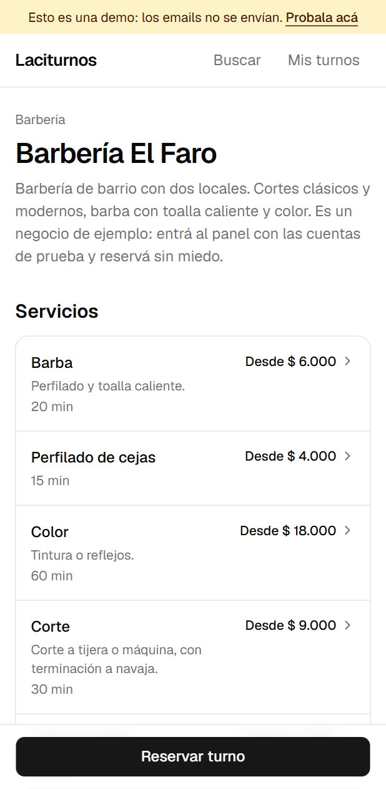
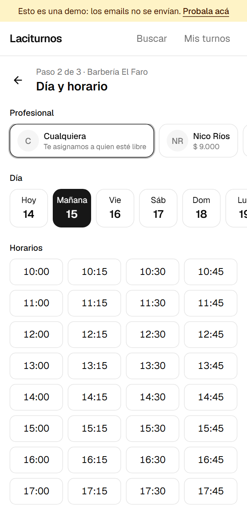
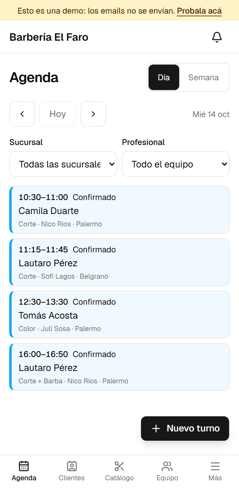
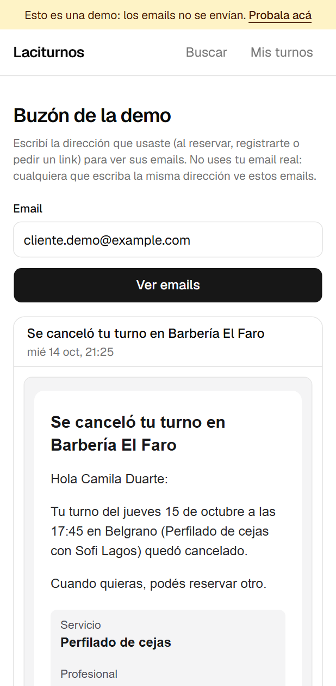
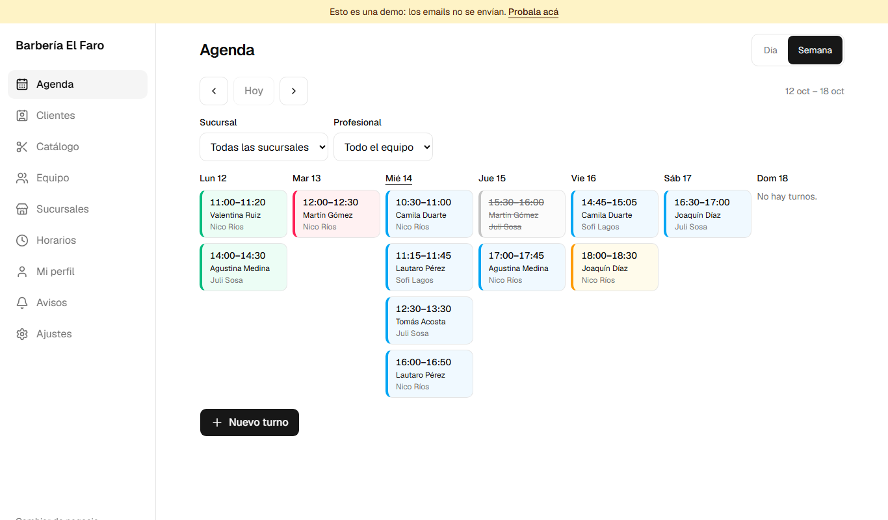
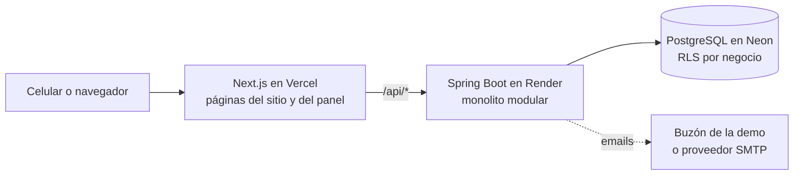

# Laciturnos

**Turnos online para barberías, centros de estética y negocios similares.** Cada negocio tiene su página pública para que sus clientes reserven desde el celular, y un panel para que el equipo maneje la agenda, los clientes, los servicios y los precios.

[](https://github.com/LautaroLacivitaDev/saas-sistema-gestion-de-turnos-lacivita/actions/workflows/ci.yml)

### 👉 [Probá la app: laciturnos.vercel.app](https://laciturnos.vercel.app)

> Es un proyecto de portfolio en modo demo: los emails no se envían, se ven en un buzón dentro de la app. Si nadie la usó en los últimos 15 minutos, la primera carga tarda alrededor de un minuto (el servidor gratuito se despierta).

---

## Cómo probarla en un minuto

1. Entrá a **[laciturnos.vercel.app/demo](https://laciturnos.vercel.app/demo)** y tocá **Entrar** en la cuenta que quieras. Todas usan la contraseña `demo1234`:

   | Cuenta | Qué ves |
   |---|---|
   | Dueña (`duena.demo@example.com`) | El panel completo: agenda, clientes, catálogo, equipo, sucursales, horarios y ajustes |
   | Gerente (`gerente.demo@example.com`) | El panel de las sucursales que maneja |
   | Profesional (`nico.demo@example.com`) | Su agenda, sus horarios, su perfil y sus avisos |
   | Cliente (`cliente.demo@example.com`) | "Mis turnos": cambiar o cancelar, y repetir una reserva |

2. Reservá como cualquier cliente en **[Barbería El Faro](https://laciturnos.vercel.app/barberia-el-faro)** con un email inventado. El código para confirmar llega al **[buzón de la demo](https://laciturnos.vercel.app/demo/emails)**, junto con el email de confirmación (con su `.ics` para el calendario).
3. Entrá como Dueña y mirá cómo aparece tu turno en la agenda.

Los datos de ejemplo vuelven a su estado inicial cada vez que el servidor arranca.

## Capturas

| Página del negocio | Elegir día y horario | Agenda (celular) | Buzón de la demo |
|---|---|---|---|
|  |  |  |  |



## Qué hace

**Para los clientes**

- Buscador de negocios que tolera errores de tipeo y tildes ("barbria palerno" encuentra "Barbería El Faro").
- Página de cada negocio con servicios, combos, profesionales, sucursales con horarios, "Cómo llegar" y QR para compartir.
- Reserva en tres pasos: servicio, día y horario (el horario queda guardado 5 minutos) y datos. Sin cuenta, con un código por email y verificación anti-bots; con cuenta, sin código.
- Email de confirmación con el turno para agregar al calendario, recordatorios y botones para confirmar, cambiar o cancelar dentro del plazo del negocio.
- "Mis turnos": próximos y anteriores en todos los negocios, cambiar o cancelar, y "repetir mi última reserva".

**Para el negocio**

- Varias sucursales, cada una con su horario, feriados, cierres y zona horaria.
- Roles: dueño, gerente y profesional. Cada uno ve y hace solo lo que le corresponde.
- Agenda por día o semana (Día por defecto en el celular), por sucursal y profesional, con turnos de mostrador y acciones según el estado (confirmar, empezar, terminar, no vino, mover, cancelar).
- Cada profesional fija su precio y su duración dentro del rango que define el dueño; fuera de rango, el gerente aprueba.
- Base de clientes con historial, notas y preferencias.
- Invitaciones al equipo por email, avisos en la app y textos de los emails personalizables.
- Alta guiada de un negocio nuevo en seis pasos.

Todo está pensado primero para el celular: una columna, botones de al menos 44 px, letra de 16 px en los formularios y la acción principal al alcance del pulgar. Se instala como app (PWA).

## Tecnologías

| Capa | Tecnologías |
|---|---|
| Backend | Java 25, Spring Boot 4.1, Spring Modulith, Spring Security (sesión en PostgreSQL), Spring Data JPA / Hibernate 7, Flyway, JobRunr, Thymeleaf (emails) |
| Base de datos | PostgreSQL 17 con Row Level Security, restricciones de exclusión, `pg_trgm` y `unaccent` |
| Frontend | Next.js 16 (App Router, Server Components), React 19, TypeScript, Tailwind CSS 4, shadcn/ui, TanStack Query, React Hook Form + Zod |
| Pruebas | JUnit 5, Testcontainers (PostgreSQL real), ArchUnit, Vitest, Playwright, k6 |
| Infraestructura | Docker, GitHub Actions, Vercel, Render, Neon, Cloudflare Turnstile |

## Arquitectura



El backend es un **monolito modular** (Spring Modulith): `business`, `users`, `catalog`, `schedule`, `booking`, `notifications` y `shared`. Cada módulo expone una API pública mínima y se comunica con los demás por esa API o por eventos; los límites entre módulos y entre capas se verifican en las pruebas.

Algunas decisiones que vale la pena mirar:

- **Aislamiento entre negocios en dos barreras:** Hibernate filtra por negocio y, además, PostgreSQL aplica Row Level Security. La aplicación se conecta con un usuario sin privilegios para saltearla.
- **Nunca hay doble reserva:** lo impide una restricción de exclusión en la base, no solo el código. Con 100 personas tomando el mismo horario a la vez, gana una y el resto recibe un 409 (prueba de carga con k6).
- **Ningún email se pierde:** los avisos se guardan en una bandeja de salida en la misma transacción que el turno y se envían con reintentos; los recordatorios se reprograman si el turno se mueve.
- **Horarios correctos en cualquier servidor:** las horas son de la sucursal y los instantes en UTC; las pruebas corren en otra zona horaria para detectar errores que dependan del servidor.
- **Modo demo honesto:** en la demo los emails nunca se envían a nadie, porque las cuentas de ejemplo son públicas.

Todas las decisiones, con su porqué, están en [docs/decisiones.md](docs/decisiones.md).

## Calidad

- **Backend:** más de 360 pruebas, incluidas las de integración contra PostgreSQL real (permisos por rol, aislamiento entre negocios, concurrencia, disponibilidad con cambios de horario) y las de arquitectura.
- **Frontend:** pruebas unitarias, lint y tipos estrictos.
- **De punta a punta:** Playwright en un celular y en escritorio: reserva completa con el código del buzón, "Mis turnos", panel y ausencia de scroll horizontal a 320 px.
- **CI:** GitHub Actions corre todo en cada push, incluido Playwright contra la app levantada.

## Correrlo en tu PC

Con JDK 25, Node 24 y Docker Desktop:

```bash
docker compose up -d                      # PostgreSQL y Mailpit

cd backend
./mvnw spring-boot:run -Dspring-boot.run.profiles=dev,demo     # Windows: mvnw.cmd

cd ../frontend
npm install
echo NEXT_PUBLIC_DEMO_MODE=true > .env.local
npm run dev                               # http://localhost:3000
```

La guía completa (pruebas, IDE, login con Google) está en [docs/desarrollo.md](docs/desarrollo.md).

## Documentación

| Documento | Qué tiene |
|---|---|
| [docs/desarrollo.md](docs/desarrollo.md) | Puesta en marcha, pruebas, IDE y estructura del repositorio |
| [docs/api.md](docs/api.md) | Endpoints de la API, pantallas y permisos por rol |
| [docs/publicacion.md](docs/publicacion.md) | Modo demo y cómo publicarlo en Vercel, Render y Neon |
| [docs/especificacion-mvp.md](docs/especificacion-mvp.md) | Especificación funcional del MVP |
| [docs/plan-mvp.md](docs/plan-mvp.md) | Plan de hitos |
| [docs/decisiones.md](docs/decisiones.md) | Registro de decisiones técnicas |

### Desarrollo asistido por IA

El proyecto se construyó con agentes de IA (Claude Code) siguiendo reglas explícitas: [AGENTS.md](AGENTS.md) define la arquitectura, las convenciones y la definición de "terminado" de cada hito, y [MEMORY.md](MEMORY.md) guarda el estado y los aprendizajes entre sesiones.

## Autor

**Lautaro Lacivita** · [GitHub](https://github.com/LautaroLacivitaDev)
